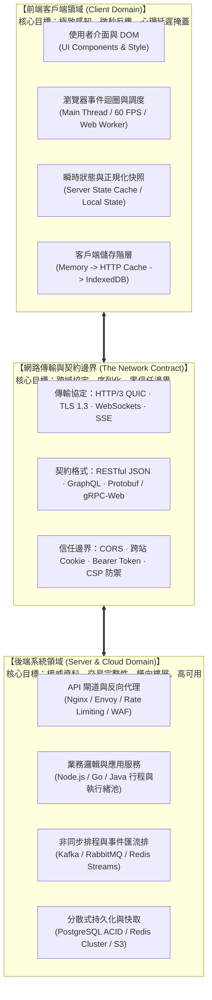

# 前端系統設計實戰學習地圖

本篇從「將瀏覽器視為分散式系統的邊緣計算節點（Edge Client Node）」出發，跨越傳統組件切版與 UI 庫套用的層次，系統性剖析大型前端應用的渲染策略、資料流拓撲、多層客戶端快取、主執行緒並行調度、即時通訊協定與防禦性可觀測架構。
不依賴抽象的一鍵生成框架，著眼於資料流如何穿越網路邊界、瀏覽器 C++ 引擎（Blink/V8）與記憶體層級，協助工程師建立具備百萬級使用者規模支撐能力的現代前端架構心智模型。

---

## 學習地圖全貌與前後端架構劃分

全路線由前後端邊界視覺化開篇，並循序推進七個漸進式架構里程碑：



### 前後端架構對稱性與核心責任矩陣

前端與後端在分散式系統設計上存在高度對稱性，但由於執行環境與極限目標不同，其工程取捨存在本質差異：

| 系統維度 | 前端客戶端架構（Frontend System Design） | 後端分散式架構（Backend System Design） | 雙方銜接契約（The Seam） |
|---|---|---|---|
| **核心優化目標** | **使用者感知延遲**（Psychological Latency）、Core Web Vitals、60 FPS 流暢度 | **系統吞吐量**（RPS / QPS）、P99 延遲、ACID 交易完整性、99.99% 可用性 | 延遲預算（Latency Budget）與 SLA/SLO |
| **運算與調度 (Compute)** | 瀏覽器單執行緒 Event Loop、時間分片（Time Slicing）、Web Workers 避讓主執行緒 | 多行程（Multi-Process）、多執行緒池（Thread Pool）、協程（Coroutines）、Goroutines | 非同步非阻塞 I/O 模型 |
| **狀態本質 (State)** | **暫存投影與樂觀狀態**（隨時可能因關閉分頁而遺失，依賴伺服器重校） | **權威持久化狀態**（Single Source of Truth，依賴 WAL 與磁碟落盤） | 狀態同步協議（Query Invalidation、ETag、WebSocket 推播） |
| **快取機制 (Cache)** | **多層本地快取**：JS 記憶體 $\rightarrow$ HTTP 磁碟快取 $\rightarrow$ Service Worker $\rightarrow$ IndexedDB | **分散式快取**：本機 L1 記憶體 $\rightarrow$ Redis/Memcached 叢集 $\rightarrow$ CDN 邊緣快取 | `Cache-Control` 標頭（`stale-while-revalidate`） |
| **錯誤容錯 (Fault Tolerance)** | **優雅降級**：錯誤邊界（Error Boundary）、局部骨架屏、離線工作佇列（Outbox） | **服務韌性**：斷路器（Circuit Breaker）、限流降級（Rate Limiting）、重試死信佇列 | 冪等性鍵（Idempotency Key）與標準 HTTP 狀態碼 |
| **安全模型 (Security)** | **零信任的執行環境**（運行在用戶機器上，源碼與記憶體完全暴露）：防禦 XSS、CSRF、點擊劫持 | **權威仲裁中心**（嚴格受保護的內網私有雲）：身分認證（AuthN）、存取授權（AuthZ）、防注入 | JWT / Session Cookie 與 CSP Nonce |

### 推薦實踐技術棧（Golden Standard Stack）

- **語言標準**：TypeScript（嚴格模式，型別作為模組邊界契約）。
- **渲染與組件架構**：React 19 / Astro（代表現代 Component-Driven、Streaming SSR 與 Islands 孤島架構）。
- **狀態與資料層**：TanStack Query（Server State）+ Zustand（Client Local State）+ IndexedDB（客戶端持久化）。
- **度量標準**：Google Core Web Vitals（LCP, INP, CLS）+ W3C Performance Observer API。

---

## 階段 0：系統邊界與性能度量（System Boundary & Metrics）

### 實踐目標
建立前端非功能性需求（NFR）度量體系，學會利用瀏覽器原生 API 量化頁面健康度與主執行緒健康狀態。

### 解開黑盒子：主執行緒幀預算與 Core Web Vitals
瀏覽器以 60 Hz 刷新率運行時，每幀只有 **16.6 毫秒（1000ms / 60）** 的時間完成 JavaScript 執行、樣式計算（Style）、版面配置（Layout）、繪製（Paint）與合成（Composite）。
若 JavaScript 執行超過 **50ms**，W3C 將其定義為 **Long Task**，主執行緒無法響應任何使用者事件，引發掉幀與輸入遲鈍。

```
 一幀時間預算 (16.6ms at 60Hz)
┌────────────────────────────────────────────────────────┐
│  JS 執行  │ Recalc Style │  Layout  │  Paint  │ Composite │
└────────────────────────────────────────────────────────┘
 ▲ 若 JS 執行超過 50ms ➔ 形成 Long Task ➔ 介面卡頓、INP 飆升
```

Google Core Web Vitals (CWV) 將使用者體驗拆解為三個黃金指標：
1. **LCP (Largest Contentful Paint，標準 < 2.5s)**：視窗內最大內容元素（圖片、影片或大文字塊）渲染完成的時間點。
   $$\text{LCP} = \text{TTFB} + \text{資源載入延遲} + \text{資源下載時長} + \text{元素渲染延遲}$$
2. **INP (Interaction to Next Paint，標準 < 200ms)**：量化使用者點擊、鍵入或輕觸後，到瀏覽器繪製出下一幀畫面的最長延遲（反映介面靈敏度）。
3. **CLS (Cumulative Layout Shift，標準 < 0.1)**：衡量頁面生命週期內所有非預期版面位移的累積分數，防範按鈕突然跳動導致誤觸。

### 最小度量監控實作（PerformanceObserver 原生捕獲）
建立 `metrics.ts`：

```typescript
// 監聽並上報 Long Task (>50ms) 與 INP 互動延遲
if (typeof window !== 'undefined' && 'PerformanceObserver' in window) {
  // 1. 監聽阻塞主執行緒的長任務
  const longTaskObserver = new PerformanceObserver((list) => {
    for (const entry of list.getEntries()) {
      if (entry.duration > 50) {
        console.warn(`[Performance] 檢測到主執行緒 Long Task: 耗時 ${entry.duration.toFixed(2)}ms`, entry);
      }
    }
  });
  longTaskObserver.observe({ type: 'longtask', buffered: true });

  // 2. 監聽使用者互動延遲 (INP 候選事件)
  const eventObserver = new PerformanceObserver((list) => {
    for (const entry of list.getEntries() as PerformanceEventTiming[]) {
      const delay = entry.processingStart - entry.startTime;
      const duration = entry.duration;
      if (duration > 100) {
        console.warn(`[INP Warning] 互動事件延遲過高: [${entry.name}] 處理延遲: ${delay.toFixed(1)}ms, 總耗時: ${duration.toFixed(1)}ms`);
      }
    }
  });
  eventObserver.observe({ type: 'event', buffered: true, durationThreshold: 40 });
}
```

### 終端與 DevTools 檢驗方式
1. 打開 Chrome DevTools ➔ **Performance** 面板。
2. 點擊 Record 錄製 3 秒，並在頁面快速點擊按鈕或輸入文字。
3. 觀察 **Main** 軌道：確認是否有帶紅斜線標記的 **Long Task (>50ms)**。

---

## 階段 1：渲染模式與水合策略（Rendering Patterns & Hydration）

### 實踐目標
依據內容即時性、SEO 需求與伺服器算力成本，在 CSR、SSR、Streaming SSR 與 Islands 架構之間做出精準的技術決策。

### 解開黑盒子：Blink 渲染管線與水合落差（Uncanny Valley）
瀏覽器加載傳統 SPA（CSR）時，HTML 僅是一個空殼（`<div id="root"></div>`），必須經歷「下載 HTML $\rightarrow$ 下載龐大 JS $\rightarrow$ 執行 JS 構建 Virtual DOM $\rightarrow$ 掛載真實 DOM」的冗長過程，導致長達數秒的白屏（白屏時間 FCP 極差）。

傳統 SSR 雖在伺服器端直出完整 HTML，讓 FCP 大幅提前，但引發了嚴重的**水合落差（Hydration Uncanny Valley）**：
- 使用者眼前看得到按鈕與輸入框（因為靜態 HTML 已渲染）。
- 但此時客戶端正在下載數 MB 的 JavaScript，並重新在記憶體中建立組件樹並綁定事件監聽器（水合流程 Hydration）。
- 在水合完成前，使用者點擊按鈕毫無反應，造成嚴重的體驗割裂與 INP 惡化。

現代架構的最佳解為 **Islands Architecture（組件孤島架構，如 Astro）**：
- 頁面預設 100% 輸出純 HTML/CSS，**零 JavaScript 負擔**。
- 僅有需要使用者互動的區域（如即時購物車、搜尋框），透過 `client:visible` 或 `client:idle` 指令宣告為獨立的客戶端孤島（Client Islands），各孤島非同步、平行完成水合，互不阻塞。

### 孤島架構水合實作（Astro 指令語法）
在 `Page.astro` 中定義不同優先級的水合邊界：

```astro
---
import StaticArticle from './StaticArticle.astro';
import InteractiveComments from './InteractiveComments.jsx';
import FloatingCart from './FloatingCart.jsx';
---

<!-- 1. 純伺服器端渲染：0kb 客戶端 JS，極速 LCP -->
<StaticArticle content={post.content} />

<!-- 2. 當組件滑動至視窗可見時才載入 JS 並水合（延遲加載） -->
<InteractiveComments client:visible postId={post.id} />

<!-- 3. 主執行緒空閒時才水合浮動購物車 -->
<FloatingCart client:idle />
```

### 終端與 DevTools 檢驗方式
1. 在 Chrome DevTools ➔ **Network** 面板中，勾選 **Disable cache**，並將網路條件模擬為 **Slow 3G**，CPU 模擬為 **4x slowdown**。
2. 測量頁面的 **TTFB**（伺服器回應時間）、**FCP**（首次繪製時間）與 **TTI**（可互動時間）。
3. 驗證在 Islands 模式下，未進入視窗的 `client:visible` 組件不會提前下載 JavaScript 代碼包。

---

## 階段 2：資料流拓撲與狀態正規化（State Topologies & Normalization）

### 實踐目標
徹底解耦伺服器狀態（Server State）與客戶端狀態（Client State），消滅深層巢狀狀態導致的 $O(N)$ 重繪，並建立高響應的樂觀更新狀態機。

### 解開黑盒子：正規化實體字典與樂觀復原
將伺服器回傳的深層巢狀 JSON（例如文章內嵌作者、作者內嵌留言陣列）直接存入 React State，會帶來三大痛點：
1. **資料冗餘與不一致**：同一個使用者的頭像更新時，必須遍歷全樹修改數百處巢狀節點。
2. **無效重繪**：巢狀物件中只要任何一層屬性變更，參考位址（Reference）改變將觸發整顆組件子樹全部重新 Render。

解法為**狀態正規化（Normalization）**：以實體 ID 為鍵，將資料展平為查表結構（Look-up Dictionary），狀態尋址複雜度由 $O(N)$ 降為 $O(1)$。

```typescript
// 扁平正規化狀態拓撲
interface NormalizedEntities {
  posts: Record<string, { id: string; title: string; authorId: string; commentIds: string[] }>;
  users: Record<string, { id: string; name: string; avatarUrl: string }>;
  comments: Record<string, { id: string; content: string; userId: string }>;
}
```

### 樂觀更新狀態機實作（兩階段復原機制）
利用 TanStack Query 實作點讚操作的樂觀更新：

```typescript
import { useMutation, useQueryClient } from '@tanstack/react-query';

export function useLikePost(postId: string) {
  const queryClient = useQueryClient();

  return useMutation({
    mutationFn: async () => {
      const res = await fetch(`/api/posts/${postId}/like`, { method: 'POST' });
      if (!res.ok) throw new Error('點讚失敗');
      return res.json();
    },
    // 1. 請求發出前：立即修改本地快取 (Optimistic Apply)
    onMutate: async () => {
      await queryClient.cancelQueries({ queryKey: ['post', postId] });
      const previousPost = queryClient.getQueryData(['post', postId]);

      // 快照當前狀態以備回滾
      queryClient.setQueryData(['post', postId], (old: any) => ({
        ...old,
        likeCount: old.likeCount + 1,
        hasLiked: true,
      }));

      return { previousPost }; // 回傳快照
    },
    // 2. 若後端報錯：依據快照無痕回滾 (Rollback)
    onError: (err, variables, context) => {
      if (context?.previousPost) {
        queryClient.setQueryData(['post', postId], context.previousPost);
      }
      alert('網路異常，點讚未能送達伺服器');
    },
    // 3. 無論成敗：重新驗證伺服器權威資料 (Settle)
    onSettled: () => {
      queryClient.invalidateQueries({ queryKey: ['post', postId] });
    },
  });
}
```

### 終端與 DevTools 檢驗方式
1. 打開 React Developer Tools ➔ **Profiler** 面板。
2. 執行操作，確認僅有對應的子節點重繪，父級與無關同級組件呈現灰色的「Did not render」。
3. 在 DevTools ➔ **Network** 面板中，使用 Request Blocking 攔截 `/api/posts/*/like` 回傳 500 錯誤，確認介面立即點讚隨後優雅復原，無跳動殘留。

---

## 階段 3：客戶端多層快取與離線韌性（Multi-tier Client Caching & Offline）

### 實踐目標
構建「記憶體 $\rightarrow$ HTTP 標頭 $\rightarrow$ Service Worker $\rightarrow$ IndexedDB」的階層式快取架構，實現無網斷線下的平滑降級。

### 解開黑盒子：客戶端快取記憶體階層
客戶端儲存媒介具備不同的存取延遲與容量限制：

```
 [L1] JS Memory Cache (TanStack Query/變數)  ──▶ ~0.1ms 延遲, 頁面重新整理即消失
   │
 [L2] HTTP Disk/Memory Cache (Cache-Control) ──▶ ~1-5ms 延遲, 受限於瀏覽器 HTTP 堆疊
   │
 [L3] Service Worker CacheStorage            ──▶ ~5-20ms 延遲, 攔截網路請求, 可程式化控制
   │
 [L4] IndexedDB (結構化資料庫)               ──▶ ~10-50ms 延遲, 支援非同步交易, 容量可達 GB 級
```

- **不可變靜態資源（JS/CSS）**：使用 `Cache-Control: public, max-age=31536000, immutable` 搭配 Content Hash。
- **即時 API 資料**：使用 `Cache-Control: no-cache` 搭配 `stale-while-revalidate`，優先回傳記憶體舊值立即渲染，非同步背景驗證更新。
- **離線寫入（Outbox Pattern）**：斷網時，使用者產生的變更不能丟棄，應序列化寫入 IndexedDB 本地待辦隊列（Outbox），連線恢復時保證依序回沖。

### 離線 Outbox 佇列實作（IndexedDB + Sync）
建立 `offlineQueue.ts`：

```typescript
const DB_NAME = 'ClientOutboxDB';
const STORE_NAME = 'mutations';

// 建立或開啟 IndexedDB
function openDB(): Promise<IDBDatabase> {
  return new Promise((resolve, reject) => {
    const request = indexedDB.open(DB_NAME, 1);
    request.onupgradeneeded = () => {
      request.result.createObjectStore(STORE_NAME, { keyPath: 'id', autoIncrement: true });
    };
    request.onsuccess = () => resolve(request.result);
    request.onerror = () => reject(request.error);
  });
}

// 離線時將操作推入 Outbox
export async function pushOfflineMutation(endpoint: string, payload: any) {
  const db = await openDB();
  const tx = db.transaction(STORE_NAME, 'readwrite');
  tx.objectStore(STORE_NAME).add({
    endpoint,
    payload,
    timestamp: Date.now(),
    idempotencyKey: crypto.randomUUID(), // 冪等鍵避免重複執行
  });
  console.log(`[Offline Outbox] 已寫入離線隊列: ${endpoint}`);
}

// 監聽連網事件，自動重送未完成任務
if (typeof window !== 'undefined') {
  window.addEventListener('online', async () => {
    console.log('[Network] 網路恢復連線，開始沖刷離線隊列...');
    const db = await openDB();
    const tx = db.transaction(STORE_NAME, 'readwrite');
    const store = tx.objectStore(STORE_NAME);
    const getAllReq = store.getAll();

    getAllReq.onsuccess = async () => {
      const tasks = getAllReq.result;
      for (const task of tasks) {
        try {
          await fetch(task.endpoint, {
            method: 'POST',
            headers: {
              'Content-Type': 'application/json',
              'X-Idempotency-Key': task.idempotencyKey,
            },
            body: JSON.stringify(task.payload),
          });
          // 成功後從本地隊列刪除
          const deleteTx = (await openDB()).transaction(STORE_NAME, 'readwrite');
          deleteTx.objectStore(STORE_NAME).delete(task.id);
        } catch (e) {
          console.error('[Offline Outbox] 重送失敗，等待下次連線:', e);
          break;
        }
      }
    };
  });
}
```

### 終端與 DevTools 檢驗方式
1. 在 DevTools ➔ **Network** 面板中，切換為 **Offline**（離線模式）。
2. 在介面發起表單送出或修改，確認請求未噴錯崩潰，而是記錄於 **Application ➔ Storage ➔ IndexedDB**。
3. 切回 **No throttling**（連線模式），觀察 Console 與 Network 面板，確認先前隊列中的任務自動依序重放。

---

## 階段 4：巨量資料渲染與並行排程調度（Virtualization & Scheduling）

### 實踐目標
在面對 100,000 筆商品資料或巨量日誌時，維持穩定的 60 FPS 捲動，並將耗時運算卸載至 Web Workers，杜絕主執行緒掉幀。

### 解開黑盒子：DOM 節點爆炸與虛擬視窗（Windowing）演算法
在網頁中掛載 10,000 個真實 DOM 節點會消耗數百 MB 記憶體。當視窗滾動時，瀏覽器對巨大的 DOM 樹執行 Recalculate Style 與 Layout 幾何定位，直接造成主執行緒凍結。

**虛擬捲動（Virtual List）** 的核心思想是：**無論資料集多大，真實存在於 DOM 樹中的節點永遠只有螢幕可視區域內的 10~20 個**。

```
                    ┌────────────────────────┐  ▲
                    │     上緩衝區 (Overscan)  │  │ 隱藏 (純計算 top 偏移量)
                    ├────────────────────────┤  ▼
 ┌──────────────┐   │                        │  ▲
 │              │   │   可見視窗 (Viewport)    │  │ 真實渲染在 DOM 的節點
 │  瀏覽器螢幕   │===│   (Visible Window)     │  │ (依據 scrollTop 計算)
 │              │   │                        │  ▼
 └──────────────┘   ├────────────────────────┤  ▲
                    │     下緩衝區 (Overscan)  │  │ 隱藏 (純計算 top 偏移量)
                    ├────────────────────────┤  ▼
                    │       未渲染區域        │
                    └────────────────────────┘
```

- **可視區間計算公式**：
  $$\text{startIndex} = \max\left(0, \left\lfloor \frac{\text{scrollTop}}{\text{itemHeight}} \right\rfloor - \text{overscan}\right)$$
  $$\text{endIndex} = \min\left(N, \left\lfloor \frac{\text{scrollTop} + \text{viewportHeight}}{\text{itemHeight}} \right\rfloor + \text{overscan}\right)$$
  $$\text{offsetY} = \text{startIndex} \times \text{itemHeight}$$

### Web Worker 零拷貝記憶體轉移（Transferable Objects）
當必須在前端進行百萬筆資料排序或模糊搜尋時，使用傳統 `postMessage` 會觸發結構化拷貝（Structured Clone），拷貝龐大記憶體會直接阻塞主執行緒 50ms 以上。
解決方案是使用 **Transferable Objects**（如 `ArrayBuffer`），實現**記憶體所有權的零拷貝瞬間轉移**：

```typescript
// 主執行緒發送大型二進位緩衝區
const buffer = new ArrayBuffer(32 * 1024 * 1024); // 32MB 資料
const worker = new Worker('compute-worker.js');

// 第二個參數傳入轉移清單 (Transfer List)：記憶體指針直接移交 Worker，主執行緒不再持有，耗時 < 1ms
worker.postMessage({ type: 'PROCESS_MATRIX', data: buffer }, [buffer]);
console.assert(buffer.byteLength === 0, '原主執行緒緩衝區已被抽離清空');
```

### 終端與 DevTools 檢驗方式
1. 打開 Chrome DevTools 按下 `Cmd+Shift+P`，輸入 **Show frames per second (FPS) meter** 開啟幀率計。
2. 在包含 100,000 筆資料的虛擬清單上極速滑動滑鼠滾輪。
3. 確認 FPS 始終穩定保持在 60 FPS，且 DevTools Elements 標籤下的 DOM 節點數量始終恆定在 30 個以內。

---

## 階段 5：即時雙向同步與通訊協定（Real-Time Protocols & CRDTs）

### 實踐目標
在 Polling、SSE（Server-Sent Events）與 WebSocket 之間依需求進行通訊選型，實作具備心跳保活與指數退避的高可用連線。

### 解開黑盒子：長連線狀態治理與假死偵測
WebSocket 提供全雙工雙向通訊，但存在「半開連線（Zombie Connection）」風險：當客戶端網路突然斷開（如進入電梯或切換 WiFi），作業系統未送出 TCP FIN 封包，瀏覽器會誤以為連線依然健在。

工業級 WebSocket 連線必須內建：
1. **心跳探活（Heartbeat Ping/Pong）**：定時由客戶端發送 Ping，若超過設定週期未收到伺服器 Pong 回應，主動拋棄連線並觸發重連。
2. **指數退避加抖動（Exponential Backoff with Jitter）**：避免伺服器重啟時，全網百萬客戶端同時發起重連造成雪崩效應（Thundering Herd）：
   $$T_{\text{wait}} = \min\left(T_{\text{max}}, T_{\text{base}} \times 2^{\text{attempt}}\right) \pm \text{RandomJitter}$$

### 生產級 WebSocket 連線管理實作
建立 `robustWebSocket.ts`：

```typescript
export class RobustWebSocket {
  private ws: WebSocket | null = null;
  private attempts = 0;
  private pingInterval: any;
  private pongTimeout: any;

  constructor(private url: string) {
    this.connect();
  }

  private connect() {
    this.ws = new WebSocket(this.url);

    this.ws.onopen = () => {
      console.log('[WebSocket] 連線成功建立');
      this.attempts = 0;
      this.startHeartbeat();
    };

    this.ws.onmessage = (event) => {
      if (event.data === 'PONG') {
        clearTimeout(this.pongTimeout);
        return;
      }
      this.handleMessage(JSON.parse(event.data));
    };

    this.ws.onclose = () => {
      this.cleanup();
      this.scheduleReconnect();
    };
  }

  private startHeartbeat() {
    this.pingInterval = setInterval(() => {
      if (this.ws?.readyState === WebSocket.OPEN) {
        this.ws.send('PING');
        // 若 5 秒內未收到 PONG，視為連線假死，強制切斷觸發重連
        this.pongTimeout = setTimeout(() => {
          console.warn('[WebSocket] 心跳超時，連線假死，強制中斷');
          this.ws?.close();
        }, 5000);
      }
    }, 30000);
  }

  private scheduleReconnect() {
    this.attempts++;
    // 指數退避演算法 + 隨機抖動
    const baseDelay = 1000;
    const maxDelay = 30000;
    const delay = Math.min(maxDelay, baseDelay * 2 ** this.attempts) + Math.random() * 1000;
    console.log(`[WebSocket] 將在 ${delay.toFixed(0)}ms 後嘗試第 ${this.attempts} 次重連...`);
    setTimeout(() => this.connect(), delay);
  }

  private cleanup() {
    clearInterval(this.pingInterval);
    clearTimeout(this.pongTimeout);
  }

  private handleMessage(data: any) {
    // 依業務處理訊息
  }
}
```

### 終端與 DevTools 檢驗方式
1. 在 DevTools ➔ **Network** 面板中篩選 **WS**。
2. 點擊連線並進入 **Messages** 頁籤，觀察定時發送的 `PING` 與收到的 `PONG` 影格。
3. 模擬後端重啟，觀察 Console 印出的重連延遲呈現 `1s -> 2s -> 4s -> 8s` 指數退避分佈。

---

## 階段 6：防禦性工程與前端可觀測性（Resilience, A11y & RUM）

### 實踐目標
確保局部組件崩潰不引發全站白屏，配置嚴格的內容安全策略（CSP），並利用 Beacon API 保證線上指標上報。

### 解開黑盒子：錯誤爆炸半徑（Blast Radius）與 Beacon 保證傳輸
在未加防護的 SPA 中，組件生命週期內的任何一個 `TypeError`（如未預期的空值存取），都會導致 React 卸載整顆 DOM 樹，造成讓使用者崩潰的「全屏白屏」。

- **錯誤邊界（Error Boundary）**：利用 `componentDidCatch` 劃定防禦邊界，將崩潰隔離在單一元件內（如局部按鈕或留言卡片），並呈現重試介面。
- **指標上報的卸載難題**：當使用者關閉瀏覽器分頁時，常規的 `fetch` 會被瀏覽器直接中斷，導致換頁或關閉時的 RUM 指標丟失；若使用同步 XHR 則會凍結換頁流程。
- **解法：`navigator.sendBeacon()`**：瀏覽器提供專門的非同步佇列，保證在背景發送小型封包（<64KB），且完全不干擾頁面卸載與跳轉。

### 生產級 ErrorBoundary 與 Beacon 指標上報實作
```tsx
import React, { Component, ErrorInfo, ReactNode } from 'react';

// 1. 局部錯誤防禦邊界
interface Props { children: ReactNode; fallbackTitle: string; }
interface State { hasError: boolean; }

export class ComponentErrorBoundary extends Component<Props, State> {
  state: State = { hasError: false };

  static getDerivedStateFromError(): State {
    return { hasError: true };
  }

  componentDidCatch(error: Error, errorInfo: ErrorInfo) {
    // 2. 使用 sendBeacon 上報異常日誌，確保不因換頁遺失
    const reportData = JSON.stringify({
      error: error.message,
      stack: error.stack,
      componentStack: errorInfo.componentStack,
      timestamp: Date.now(),
      url: window.location.href,
    });

    if (navigator.sendBeacon) {
      navigator.sendBeacon('/api/telemetry/errors', reportData);
    } else {
      fetch('/api/telemetry/errors', { method: 'POST', body: reportData, keepalive: true });
    }
  }

  render() {
    if (this.state.hasError) {
      return (
        <div class="p-4 border border-red-500/30 rounded bg-red-950/10 text-center">
          <p class="text-sm text-red-400">{this.props.fallbackTitle} 暫時無法載入</p>
          <button
            onClick={() => this.setState({ hasError: false })}
            class="mt-2 text-xs px-3 py-1 bg-red-800 text-white rounded hover:bg-red-700"
          >
            點擊重試
          </button>
        </div>
      );
    }
    return this.props.children;
  }
}
```

### 終端與 DevTools 檢驗方式
1. 在受 `ComponentErrorBoundary` 包覆的子組件中人為拋出例外（`throw new Error('Test Crash')`）。
2. 驗證頁面其餘區域（導航列、側邊欄）依然正常可點擊，崩潰區域精確降級為重試按鈕。
3. 查看 DevTools ➔ **Network** 面板，確認出現送往 `/api/telemetry/errors` 的 `ping` 類型 Beacon 請求。

---

## 學習地圖與 CarlAcademy 深度專案索引對照

當在實際操作過程中需要深入理解底層通訊、系統調度或快取原理時，請連回以下各專案主題進行深度查閱：

| 實戰里程碑 | 當前前端設計環節 | CarlAcademy 深入主題對照 |
|---|---|---|
| **階段 0 & 1** | 首屏渲染管線、Core Web Vitals、Islands 架構 | [電腦網路：HTTP 演進與 QUIC](../networking/http-evolution-and-quic.md)、[API：REST 架構約束](../api/rest-architectural-constraints.md) |
| **階段 2** | 資料正規化、樂觀更新、狀態機 | [關聯式資料庫：正規化](../relational-databases/normalization.md)、[快取架構：雙寫一致性](../caching/cache-database-consistency-patterns.md) |
| **階段 3** | HTTP 快取、Service Worker、IndexedDB 離線 | [快取：多層快取設計與整合](../caching/multi-tier-caching-and-end-to-end-case.md)、[Web 資安：敏感資料儲存](../web-security/secrets-and-sensitive-data.md) |
| **階段 4** | 主執行緒調度、Web Workers、虛擬滾動 | [程式執行與並行：Process 與 Thread 排程](../concurrency/process-and-thread-scheduling-context-switch.md)、[並行：無鎖佇列與環狀緩衝](../concurrency/lock-free-queues-and-the-disruptor-ring-buffer.md) |
| **階段 5** | 即時長連線、WebSocket、訊息去重 | [訊息佇列：發布確認與消費確認](../event-driven-architecture/publisher-confirms-and-consumer-acks.md)、[分散式系統：部分失敗與系統模型](../distributed-systems/partial-failure-and-system-models.md) |
| **階段 6** | 錯誤邊界、CSP 安全邊界、RUM 可觀測性 | [Web 資安：跨站腳本 (XSS) 防禦](../web-security/cross-site-scripting.md)、[分散式系統：可觀測性與故障測試](../distributed-systems/observability-and-fault-testing.md) |
